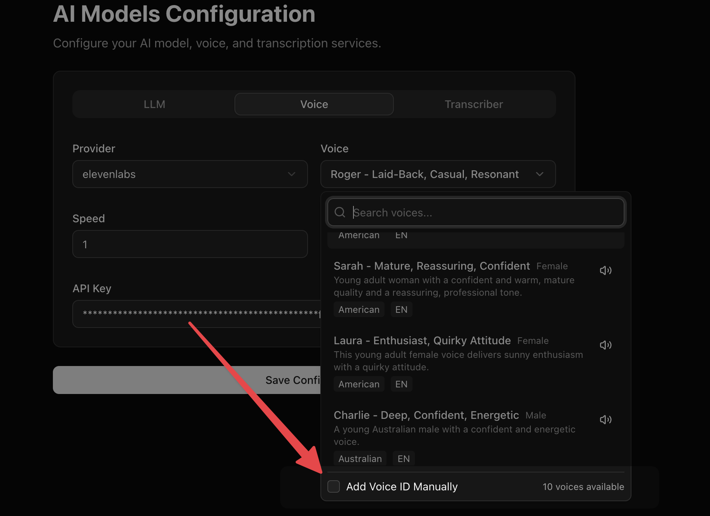

Dograh platform supports ElevenLabs, OpenAI, Google, Azure Speech, Deepgram, Cartesia, Smallest AI, MiniMax, Gnani, Sarvam, Rime, Inworld, Camb.ai, xAI, LMNT, Murf, Speechify, and Dograh TTS engines. There are some voices from the providers that we ship by default. You can refer to the providers API documentation to select a voice ID that's most relevant for your language requirement.

<Warning>
Voice providers receive the data needed to synthesize speech, such as generated text, selected voice, model settings, and request metadata. Review the provider's data processing, retention, model training, and regional hosting policies before using sensitive data.
</Warning>

For locally deployed or self-hosted TTS models, Dograh also supports Speaches, an OpenAI API-compatible server for speech generation.

If you don't find your favourite voice, you can always add the voice ID manually.

## Gnani Timbre

Save a Gnani API key in **Provider Connections**, then select that connection in your model configuration’s **TTS** tab. You can reuse the same connection for Prisma transcription when the key has access to both services. [Get a Gnani API key](https://app.gnani.ai/voice).

Choose **timbre-v2.5** for 42 voices (default **Pranav**) or **timbre-v3.0** for 13 voices (default **Avinash**). The voice list changes with the model. [Gnani voice catalog](https://docs.gnani.ai/api/TTS/available-voices)

Set **Language** to **auto** for text-based detection or choose Bengali, English, Gujarati, Hindi, Kannada, Malayalam, Marathi, Punjabi, Tamil, or Telugu. **Speed** ranges from 0.85 to 1.15 and defaults to 1.0. Dograh streams speech over WebSocket and uses the Gnani Pipecat adapter to handle interruptions. [WebSocket API](https://docs.gnani.ai/api/TTS/tts-websocket)

With Timbre v3.0 you can include an audio tag directly in a greeting, such as `Let me check. <pauses> Your order is ready.` [Gnani audio tags](https://docs.gnani.ai/api/TTS/tts-audio-tags)
